<div align="center">

# 🎓 ЭСТ · Электронная система тестирования студентов

**Тесты, расписание, учебный план и ведомости — в одной системе, построенной на структуре реального вуза**


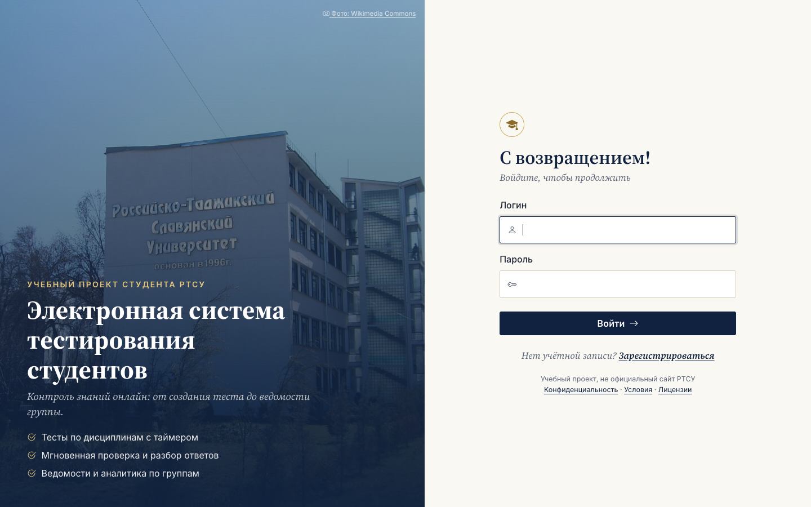

</div>

## 👋 Привет! Я Тимур Чибряков

Студент **Российско-Таджикского (Славянского) университета**. Это мой проект — электронная система тестирования
студентов для РТСУ: от анализа предметной области и UML-диаграмм до работающего веб-приложения с базой данных,
REST API и автотестами.

Идея простая: преподавателю не нужно проверять тесты вручную и заполнять ведомости, а студенту — ждать результат.
Система знает учебный план вуза — у какой группы какой предмет, кто его ведёт и экзамен это или зачёт, —
поэтому сама разграничивает доступ и сама заполняет ведомость.

<table>
<tr>
<td align="center"><b>15</b><br>таблиц в БД</td>
<td align="center"><b>3</b><br>роли</td>
<td align="center"><b>6</b><br>групп · 99 студентов</td>
<td align="center"><b>154</b><br>пары в расписании</td>
<td align="center"><b>49</b><br>автотестов</td>
<td align="center"><b>47</b><br>проверок в Postman</td>
</tr>
</table>

---

## 01 — Что умеет система

| Для кого | Что может |
|---|---|
| 🧑‍🎓 **Студент** | видит тесты **только своей группы**, проходит их с таймером, сразу получает результат с разбором; расписание своей группы и ближайшие экзамены на главной |
| 👩‍🏫 **Преподаватель** | создаёт тесты **только по своим дисциплинам**, загружает вопросы **из Excel**, видит результаты своих групп и «Моё расписание» |
| 🛠 **Администратор** | ведёт группы, учебный план и расписание, формирует **ведомость в один клик**, смотрит аналитику, управляет пользователями и журналом действий |

**Ключевые возможности**

- **Учебный план** — для пары «группа + дисциплина»: преподаватель, семестр, форма контроля (экзамен / зачёт / дифф. зачёт)
- **Ведомость** — выбираешь группу и дисциплину, а факультет, кафедра, преподаватель, курс, семестр и форма контроля подставляются сами; печать / PDF, CSV, Excel
- **Расписание** — недельная сетка с **числителем и знаменателем**, расписание сессии с отсчётом «через N дней»
- **Защита от списывания** — перемешивание вопросов и вариантов, лимит попыток и пауза между ними
- **Автосохранение ответов** — если пропал интернет или вышло время, засчитываются сохранённые ответы
- **Правильные ответы и пояснения** — преподаватель решает, показывать их сразу, после последней попытки или никогда; оценки можно выдавать после проверки
- **Качество вопросов** — система отмечает вопросы, которые плохо отделяют знающих студентов от незнающих
- **Импорт вопросов из Excel** — по шаблону, «всё или ничего», с номером строки в ошибке
- **Аналитика** — успеваемость по тестам, сложность вопросов, сравнение групп, рейтинг студентов
- **Журнал действий** — кто и когда изменил тесты, расписание, учебный план, пользователей
- **Удобное прохождение** — панель с номерами вопросов, флажок «вернуться позже», сводка перед отправкой, ответы клавишами 1–9
- **Мобильная версия** — боковое меню превращается в выезжающую панель, все страницы адаптированы

## 02 — Скриншоты

<table>
<tr>
<td width="50%">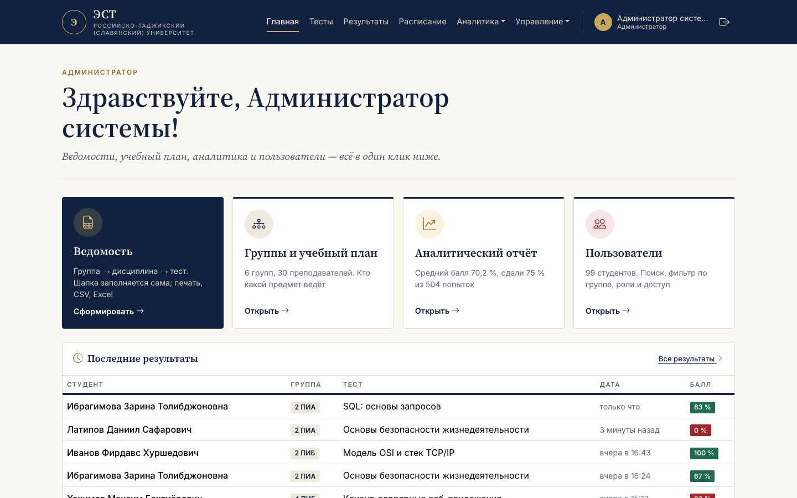<br><sub><b>Главная администратора</b> — главные действия в один клик</sub></td>
<td width="50%">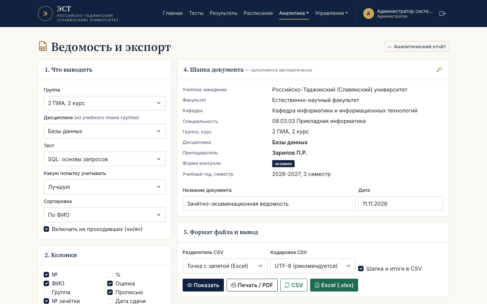<br><sub><b>Ведомость</b> — шапка заполняется из учебного плана</sub></td>
</tr>
<tr>
<td>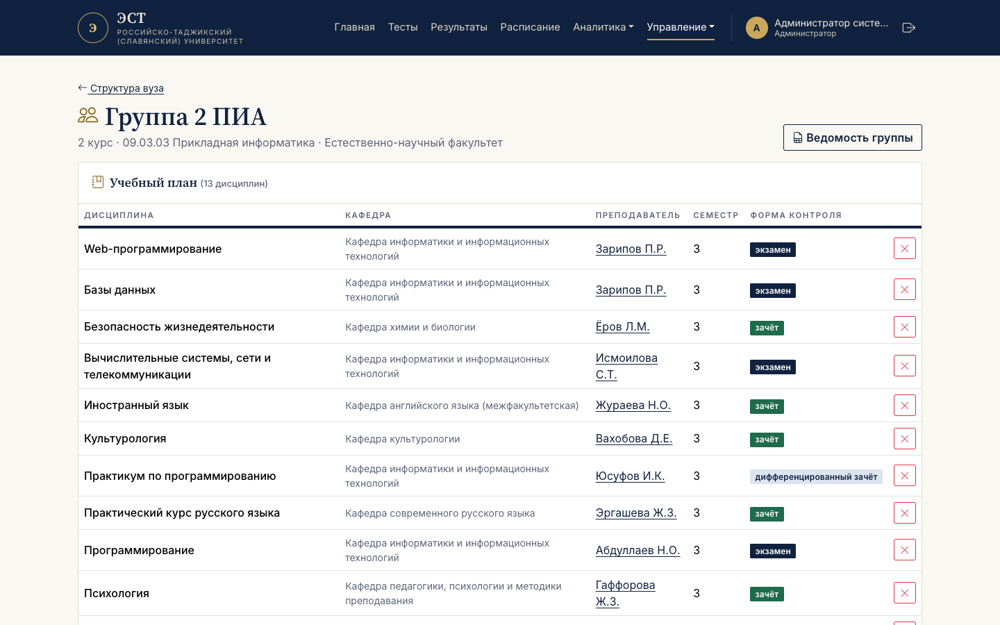<br><sub><b>Учебный план группы</b> — кто какой предмет ведёт</sub></td>
<td>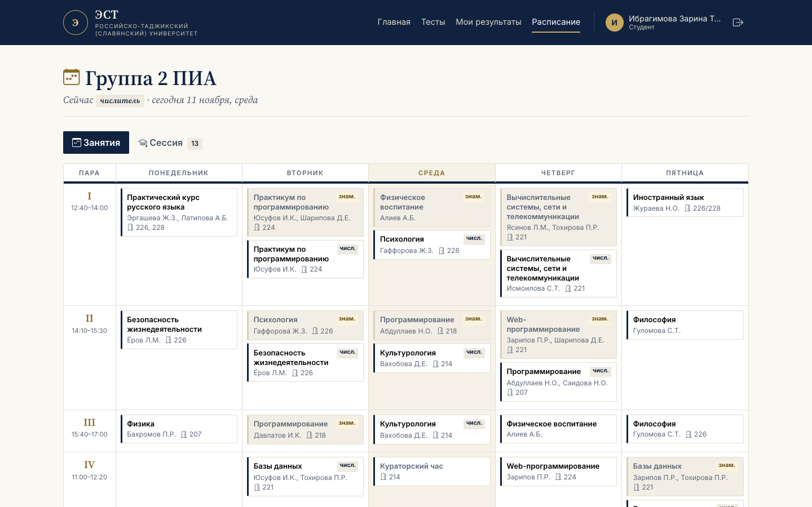<br><sub><b>Расписание</b> — числитель и знаменатель, сегодняшний день подсвечен</sub></td>
</tr>
<tr>
<td>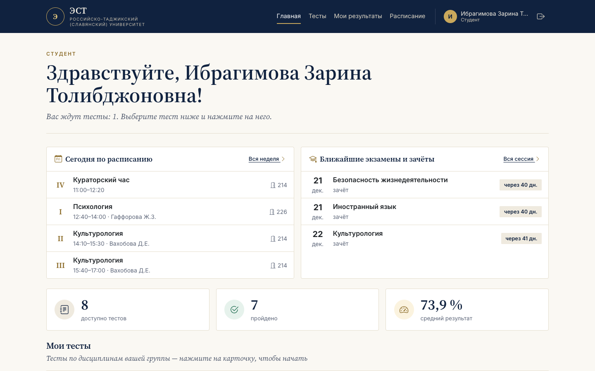<br><sub><b>Главная студента</b> — пары на сегодня, экзамены, свои тесты со статусом</sub></td>
<td>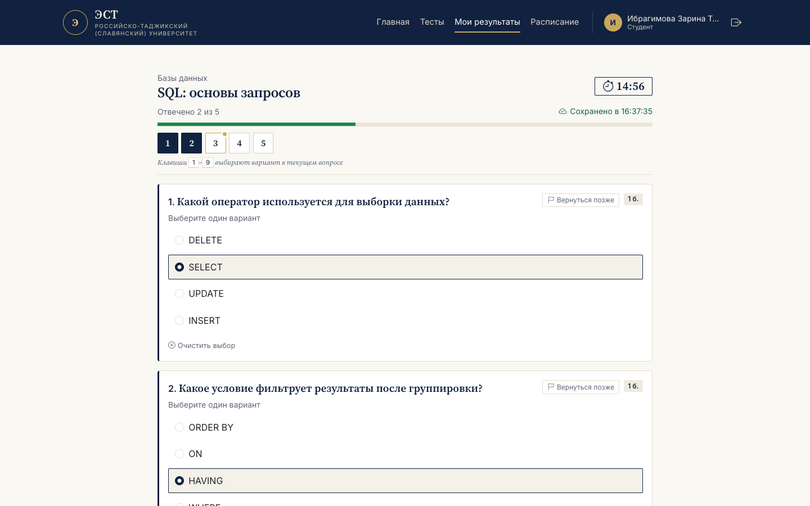<br><sub><b>Прохождение</b> — таймер и прогресс «отвечено N из M»</sub></td>
</tr>
<tr>
<td>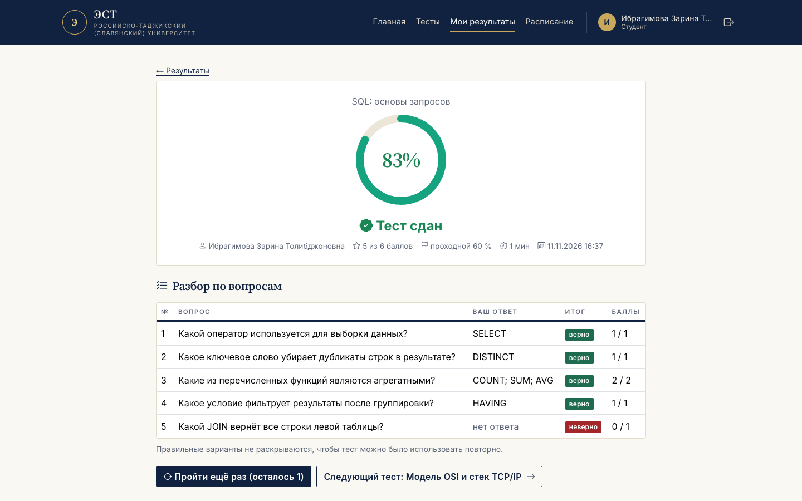<br><sub><b>Результат</b> — кольцо с процентом и разбор по вопросам</sub></td>
<td>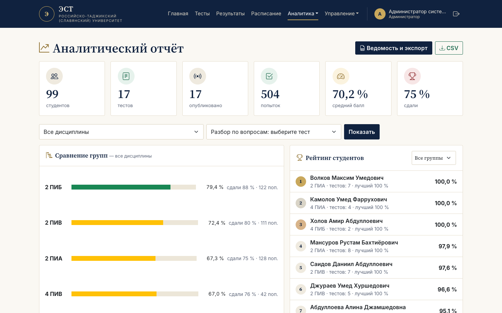<br><sub><b>Аналитика</b> — сравнение групп и рейтинг студентов</sub></td>
</tr>
<tr>
<td>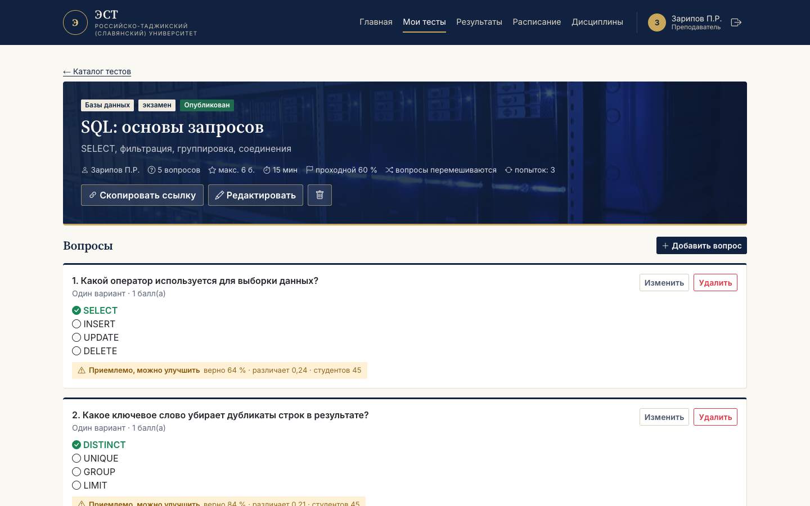<br><sub><b>Карточка теста</b> — вопросы, настройки, импорт из Excel</sub></td>
<td align="center">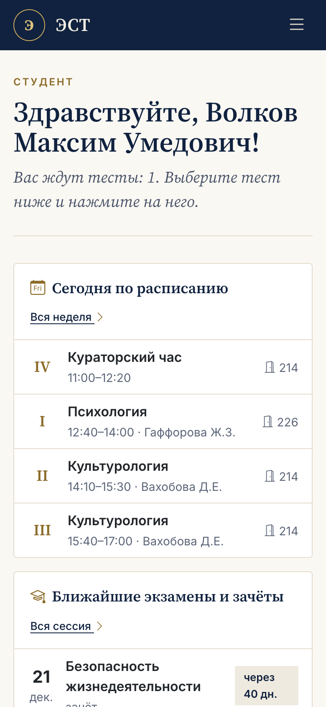<br><sub><b>Мобильная версия</b></sub></td>
</tr>
</table>

<sub>Скриншоты сделаны на демонстрационных данных: студенты и преподаватели вымышленные.</sub>

## 03 — Стек

| Слой | Технологии |
|---|---|
| Backend | Java 17 · Spring Boot 3.5 (Web, Security, Data JPA, Validation) · Hibernate 6.6 |
| База данных | PostgreSQL 18 · Flyway (8 миграций) |
| Frontend | Thymeleaf 3.1 · Bootstrap 5.3 · Bootstrap Icons · шрифты Inter и Source Serif 4 (всё подключено локально — работает без интернета) |
| Документы | Apache POI — ведомость и импорт вопросов в Excel |
| Тестирование | JUnit 5 · MockMvc · H2 · Postman / Newman |
| Инструменты | Maven · Git · PlantUML |

## 04 — Быстрый старт

**Нужно:** JDK 17+, Maven 3.9+ (или встроенный Maven Wrapper), PostgreSQL 14+.

```sql
CREATE USER testing_app WITH PASSWORD 'ваш_пароль';
CREATE DATABASE testing_system OWNER testing_app;
```

```bash
cp .env.example .env          # задайте пароли: DB_PASSWORD, ADMIN_PASSWORD, DEMO_PASSWORD, DEMO_TEACHER_PASSWORD
./run.sh                      # или двойной щелчок: «Запустить.command» (macOS) / «Запустить.bat» (Windows)
```

Сайт: **http://localhost:8080**. Таблицы создаются миграциями Flyway, база заполняется демо-данными:
6 групп, 30 дисциплин, 30 преподавателей, 99 студентов, расписание, сессия и 17 тестов с историей прохождения.

**Вход:** администратор — `admin` / `ADMIN_PASSWORD`; преподаватели и студенты — логины транслитом
(`фамилия.инициалы`), полный список создаётся в `data/accounts.csv`; пароли — `DEMO_TEACHER_PASSWORD` и `DEMO_PASSWORD`.

> Своё расписание вуза можно загрузить из `data/university.json` — папка `data/` в Git не попадает.
> Без неё загружается демо-набор `src/main/resources/seed/demo-university.json` с вымышленными преподавателями.

Запуск на своём сервере с доменом, HTTPS и резервными копиями: [docs/DEPLOY.md](docs/DEPLOY.md).

## 05 — Архитектура

```
Браузер / Postman
       │  HTTP (форма входа + сессия  |  HTTP Basic для API)
       ▼
Spring Security ── роли + проверка по учебному плану (на сервере, а не только в меню)
       ▼
web/  (Thymeleaf)      api/  (REST, JSON)        ← одни и те же сервисы, правила не дублируются
       ▼
service/  тесты · попытки · ведомость · расписание · отчёты · журнал действий
       ▼
repository/  Spring Data JPA  ──►  PostgreSQL (15 таблиц, Flyway)
```

```
src/main/java/ru/edu/testing
├── api/          REST-контроллеры и обработчик ошибок API
├── web/          страницы (Thymeleaf) и обработчик ошибок
├── service/      бизнес-логика
├── repository/   Spring Data JPA
├── domain/       сущности: структура вуза, учебный план, расписание, тесты, попытки, журнал
├── dto/          формы и DTO
├── security/     пользователь Spring Security, защита от подбора пароля
└── config/       безопасность, начальные данные
docs/             UML-диаграммы (PlantUML), ER-диаграмма, скриншоты
postman/          коллекция Postman
```

Диаграммы: [вариантов использования](docs/diagrams/use_case.png) · [классов](docs/diagrams/class.png) ·
[деятельности](docs/diagrams/activity.png) · [последовательности](docs/diagrams/sequence.png) ·
[ER](docs/diagrams/er.png) · [компонентов](docs/diagrams/component.png) · [развёртывания](docs/diagrams/deployment.png)

## 06 — REST API

| Метод | Путь | Доступ |
|---|---|---|
| POST | `/api/auth/register` | все (регистрация студента в группу) |
| GET | `/api/auth/me` | авторизованные |
| GET | `/api/tests?q=&subjectId=&sort=` | по учебному плану: студент — своя группа, преподаватель — свои дисциплины |
| POST / PUT / DELETE | `/api/tests[/{id}]`, `/api/tests/{id}/questions`, `/api/questions/{id}` | автор теста, администратор |
| POST | `/api/tests/{id}/attempts`, `/api/attempts/{id}/submit` | студент |
| GET | `/api/attempts?q=&testId=&subjectId=&passed=&groupId=&sort=` | свои / своих групп / все |
| GET | `/api/schedule/groups/{id}`, `/api/schedule/teachers/{id}` | своя группа / своё расписание / администратор |
| GET / POST | `/api/groups`, `/api/groups/{id}/curriculum` | чтение — все, изменение — администратор |
| GET | `/api/reports/summary`, `/api/reports/tests` | администратор |
| GET / POST / PATCH / DELETE | `/api/users?q=&role=&groupId=` | администратор |

Коллекция Postman: [`postman/student-testing-system.postman_collection.json`](postman/student-testing-system.postman_collection.json) —
задайте `adminPassword` и `teacherPassword` и нажмите Run: 25 запросов, 47 проверок.

## 07 — Тестирование

```bash
mvn test        # 49 тестов: 43 интеграционных сценария + 6 модульных
```

Интеграционные тесты проходят весь стек — Spring Security, контроллеры, сервисы, БД (H2 в режиме PostgreSQL):
авторизация и защита от подбора, CSRF, CRUD, поиск и фильтры, прохождение теста, права по учебному плану,
ведомость (экзамен и зачёт, CSV и Excel), расписание, лимит попыток, перемешивание, импорт из Excel,
журнал действий, смена пароля, аналитика.

## 08 — Безопасность

- пароли — только хеш **BCrypt**; секреты — в `.env`, который не попадает в Git
- права проверяются **на сервере**: роль + учебный план (студент не откроет чужую группу даже по прямой ссылке)
- студенту не передаются правильные ответы — ни при прохождении, ни в результатах
- блокировка входа после 5 неудачных попыток; CSRF-защита форм; cookie `HttpOnly` + `SameSite`
- **Content-Security-Policy** только для собственного домена, `X-Frame-Options: DENY`
- параметризованные SQL-запросы, сортировка по белому списку, экранирование вывода (XSS), защита от CSV-инъекции
- ограничение размера загружаемых файлов; все изменения данных пишутся в журнал действий
- согласие на обработку данных при регистрации, [политика конфиденциальности](src/main/resources/templates/legal/privacy.html) и обезличивание журнала при удалении пользователя

## 09 — Фото и лицензии

Фотографии РТСУ и обложки дисциплин — настоящие снимки с Wikimedia Commons под свободными лицензиями,
авторы перечислены в [docs/IMAGE_CREDITS.md](docs/IMAGE_CREDITS.md) и на странице сайта `/credits`.

---

<div align="center">

**Тимур Чибряков** · Российско-Таджикский (Славянский) университет · 2026

[GitHub](https://github.com/ChibryakovT)

</div>
